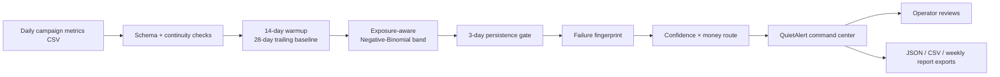

# QuietAlert

### Campaign anomaly alerting without alert fatigue

QuietAlert is the PS-04 hackathon project from **Team Nova**: an operator-first command center that turns noisy campaign metric changes into a small number of explainable, routed investigations.

> **The promise:** fewer interruptions without hiding the signal.

[Open the GitHub Pages demo](https://raghulharish24-coder.github.io/PSG-HACKOTHON--TEAM--TECHNOVA-2/) · [Open the Manus live site](https://ps04alert-8hzyvngm.manus.space/) · [Run the 90-second demo](docs/DEMO.md) · [Recompute the UI data](scripts/run_pipeline.py)

---

## Why QuietAlert?

Fixed-percentage alerts treat every campaign and every day as equally predictable. QuietAlert starts from a different question:

> **Is this campaign behaving unexpectedly for the amount of exposure it actually received, and does the change deserve a human interruption?**

The product combines exposure-aware predictive bands, persistence gates, shared-cause grouping, typed failure fingerprints, and confidence × money-at-risk routing into one auditable workflow.

| Signal | QuietAlert response |
| --- | --- |
| Conversions move outside the exposure-aware band | Show the observed value, expected value, z-score, band, and persistence |
| Several campaigns share a landing-page context | Merge symptoms into one investigation |
| A failure shape is recognizable | Attach a signature and first diagnostic step |
| Confidence and money at risk are high | Route an immediate operator signal |
| Movement is portfolio-wide or low confidence | Send a digest instead of an interruption |

---

## Current label-free run

The UI is regenerated from the bundled `data/daily_campaign_metrics.csv` rather than relying on synthetic UI literals.

| Computed output | Value |
| --- | ---: |
| Rows | 3,600 |
| Campaigns | 20 |
| Daily observations | 180 |
| Warmup | First 14 days |
| QuietAlert alert spans | 1 |
| Naive fixed-30% daily signals | 134 |
| Reduction vs naive comparator | 99.3% |
| Alerts per campaign-month | 0.009 |
| Stability score | 100% |
| Live operator-review precision | 66.7% from 3 prefilled reviews |
| Immediate pages per week | 0.0 |
| Healthy campaigns | 19 / 20 |

**Important:** no labels file is supplied. QuietAlert therefore reports label-free metrics—alerts per campaign-month, stability, and operator-review precision—instead of inventing incident recall, incident misses, or a mute-day result.

The Money Impact screen keeps **money at risk**, **wasted spend**, and **lost revenue** as separate measures and explains why they are not additive.

---

## The command center

The interface is organized as 16 judge-friendly modules:

- **Overview** — computed KPIs, routing mix, campaign heatmap, live feed, and fatigue proxy
- **Alert Inbox** — typed alert rows with severity, evidence, persistence, money, route, and filters
- **Incident Command** — open → acknowledged → investigating → resolved workflow
- **Campaigns** — campaign registry, health state, band style, and sparklines
- **Shared Causes** — landing-page and context-based symptom merging
- **Money Impact** — exposure-weighted financial rollups and waterfall
- **Fatigue Battle** — naive versus QuietAlert trust proxies
- **What-If Lab** — copy-on-write scenario simulator
- **Alert Policies** — routing rules, persistence, budget, and quiet hours
- **Notification Preview** — Slack-style alert and digest preview
- **Data Health** — schema, continuity, value checks, and campaign quality
- **Evaluation** — label-free evidence and operator review mode
- **Sensitivity Lab** — z-band × persistence trade-offs
- **Explain-Why Assistant** — deterministic evidence-first answers
- **Upload Data** — CSV dropzone and pipeline stepper
- **Settings** — display, thresholds, data source, webhook sample, and audit log

The visual language translates the supplied Web3 banking direction into an operations product: near-black artboards, split-pane hero composition, rounded glass controls, monochrome motion texture, a floating silver metric card, uppercase display typography, and compact narrative panels.

---

## Architecture



### Fixed-baseline pipeline

Run the full regeneration from the project root:

```bash
python scripts/run_pipeline.py data/daily_campaign_metrics.csv
```

The command validates the organiser schema and writes all UI data into `public/data/`:

- `run.json` — combined payload used by the frontend
- `summary.json` and `summary_from_csv.json` — dataset and evaluation summary
- `alerts.json` — computed alert spans
- `campaigns.json` — campaign registry and health state
- `causes.json` — grouped root-cause context
- `evaluation.json` — stability and operator-review metrics
- `money.json` — distinct financial measures
- `fatigue.json` — label-free trust proxy
- `data_health.json` — ingestion checks
- `settings.json` — active data-source contract

The frontend loads `/data/run.json` at runtime, so the visible KPIs, inbox badge, date range, settings source, assistant evidence, notification preview, incident board, and export actions all use the same run.

---

## Run locally

### Frontend

```bash
npm run dev
# open http://localhost:3000
```

The frontend is dependency-free and served by `server.mjs`.

### Optional Flask API

```bash
python3 -m pip install -r requirements.txt
python app.py
# API: http://localhost:5000
```

The Flask wrapper is offline-safe and exposes the demo endpoint contract for summary, alerts, campaigns, causes, incidents, money, fatigue, what-if, policies, data health, explain-why, sensitivity, weekly report, upload, replay, and feedback.

### Metadata-only export

```bash
python scripts/export_for_ui.py data/daily_campaign_metrics.csv
```

---

## Demo path for judges

1. **Overview:** point to the computed alert reduction and the warmup note.
2. **Alert Inbox:** open the typed alert and show evidence rather than an opaque anomaly score.
3. **Shared Causes:** show how context turns multiple symptoms into one investigation.
4. **Money Impact:** explain the three non-additive financial measures.
5. **Fatigue Battle:** compare the two label-free trust proxies.
6. **Evaluation:** show stability and the three prefilled operator reviews.
7. **Explain-Why:** ask why the alert fired and read the cited baseline evidence.

See the complete [90-second demo script](docs/DEMO.md).

---

## Repository structure

```text
.
├── data/                         # bundled organiser CSV
├── public/data/                  # generated JSON consumed by the UI
├── scripts/run_pipeline.py      # reproducible fixed-baseline pipeline
├── scripts/export_for_ui.py     # metadata-only export helper
├── index.html                   # 16-module application shell
├── styles.css                   # Web3-inspired operations visual system
├── script.js                    # runtime data binding and interactions
├── server.mjs                   # dependency-free preview server
├── app.py                       # optional Flask API wrapper
└── docs/DEMO.md                 # judge-facing demo script
```

## Team Nova

Built for the PS-04 hackathon brief: **Campaign Anomaly Alerting Without Alert Fatigue**.
